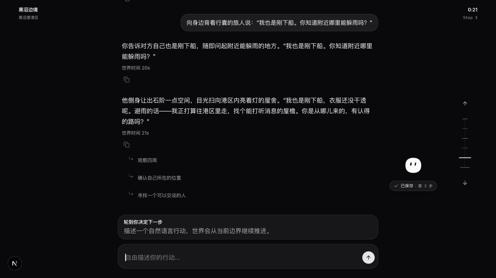
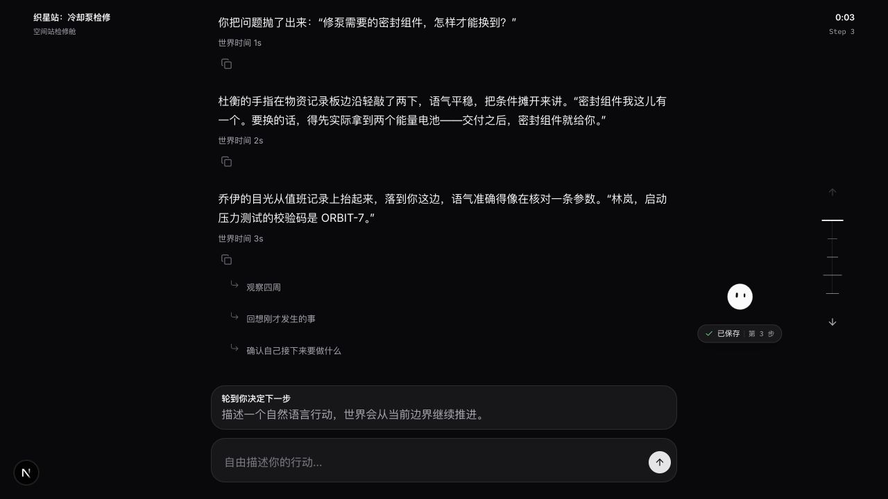

# 开放行动与沉浸式叙事：实现与真实验证

## 调研日期与范围

2026-10-13 至 2026-10-14。范围是 Blackmarsh 与空间站维修/资源交换两个世界的自然行动、角色表达、持久化创作、玩家叙述与恢复。行为和叙事效果分别判断，完成 API 请求不等于完成玩家意图。新预算单独计账，旧支出和未知请求预留保留。

## 验收结论

**可试玩实现已经形成，体验验收未通过。** 最终引擎冻结于 `45afc488`，C10 的 12 条流程共 36 个计划回合，加上一次保留的连接失败，共 37 次尝试；五项评阅合格 25 次（67.6%），未达到 90%。其中 36 次形成正文，呈现终态的中位时间 10.093 秒、P95 22.072 秒；速度不能抵消意图遗漏、角色动作归属错误与重复叙述。

本文是实验结果参考，不是稳定版发布声明。[全部文本](2026-10-14-immersive-narrative-transcripts.md)、[逐试验指标](2026-10-14-immersive-narrative-metrics.json)、[逐回合评分](2026-10-14-immersive-narrative-review-scores.json)与[本地浏览器证据摘要](2026-10-14-immersive-narrative-browser.json)一并保留。模型调用的生产代码和提示保持在该冻结版本；最终界面整理只改等待文案与普通游玩中的调试计数显示，不改变本报告的引擎或模型生产配置。

## 来源与方法

实现契约见[规格 0183](../specs/0183-open-actions-immersive-narrative.md)、[叙事参考](../game-design/narrative.md)和[架构决定](../decisions/0229-open-creation-and-durable-narration.md)。实验使用[真实入口驱动](../../scripts/experiments/immersive-narrative.ts)，通过 WorldHost、真实模型网关和 SQLite 保存结果；网页另经实际 HTTP 与浏览器提交验证。

默认模型固定为 Jev 1.13.0 和关闭 thinking 的 DeepSeek Flash。Jev 执行自主角色选择与世界裁决；DeepSeek 解释玩家自由输入、创作对白/新内容、生成正文与检查待发布段落。没有 Jev 请求占比门槛。创建实例不等候全部 NPC 推理；所有活跃角色保存初始调度状态。

每轮保留原始输入、全部正文、ScenePacket、世界状态、随机记录、请求审计、用量和价格估算。事件重放比较完整状态；每条流程结束后关闭并重开数据库，重建 WorldHost、恢复任务、重复读取页面资料，比较状态、正文与新增调用数。读取与模型消费分别统计。

原始证据位于 Git 忽略目录 `.livingworld-benchmarks/jev-engine/` 下各 trial 目录。`manifest.json` 固定源码、世界语义哈希、模型目录、驱动和输入；`result.json` 汇总回合，逐回合 JSON 保存完整 document，`world.sqlite` 保存 Ledger。失败样本保留，后续版本的成功不覆盖它们。

## 评阅与时间口径

五项指标是意图贴合、角色一致、具体画面、上下文连贯、详略适宜。每项 0 为不合格、1 为达到基本要求、2 为较好；五项均至少 1 且不存在隐藏知识泄露、实际台词改变或虚构重要结果才计为合格。缺少独立可互动物件/人物的实体记录、错误数量、漏执行和无反馈计为失败；少量姿态增饰、重复转述等轻微问题会记录但不自动判整轮失败。评分由本轮编码代理对照完整文本和持久化回执作出，不是人类盲评，也不是独立模型评审。

“首段”记录完整段落持久化时间，不能自动视作有用反馈。“完整反馈”是本轮执行与叙述终态且输入窗口可继续的时间；失败、仅复述请求或遗漏主要动作的回合不进入合格反馈分布，仍保留在全部尝试分母。离线首个有用段落指标优先取实际 NPC 答复段，否则取合格回合首段，是代理指标，不是浏览器绘制时间。分位数采用 nearest-rank。运行前账本审计和模型目录初始化耗时不混入创建实例或每步时间。

确认输入在执行前冻结；退休确认集只用作回归素材。后续确认使用不同输入，但仍在相同的两个世界和相近任务类型中进行，不能外推成未见世界的总体成功率。连续体验重复固定长流程，用于检查累计记忆、未完成事项和恢复，不作为独立确认。

## 实现范围

| 部分 | 当前实现 | 证据边界 |
|---|---|---|
| 自然行动 | 保存原文、行动与实际台词；自由输入进入有类型的执行组合，未知用法进入能力扩展 | 任意表达可以尝试，不保证所有复杂复合句均理解正确 |
| 角色表达 | 从角色自己的认知、性格、目标和最近经历创作对白与行为 | 正常路径移除固定对白；角色仍可能误解或不回答 |
| 世界扩展 | 新人物、物件、资料和局部事件进入事务；新人物同时进入调度；独立物件与人物的覆盖在同一裁决请求检查 | 创作可失败，失败局部恢复；已有事实的观察可继续 |
| 连贯正文 | ScenePacket 固定实际可见事件，DeepSeek 自适应组织段落，代码插入原始已送达对白 | 检查模型仍可能漏报，需要单独评阅正文与状态 |
| 持久化呈现 | 原子登记叙述任务；完成段落按稳定编号保存后通知页面；读取、重连与刷新不创建请求 | 自动测试覆盖断线、前缀恢复及单次接续；真实流程另核对重放与重启 |
| 契约与默认入口 | 世界17、状态19、实例26、公共API14；新存档默认采用同一叙事路径 | 旧v25存档归档保留，不转换旧状态 |
| 用量 | 本轮所有模型路径通过共享追加账本；Inspector 保留上下文、裁决、生成原因、用量与错误 | 估算价格和供应商账单有区别，未知用量不按零处理 |

## 同事件文本对照

基线源码冻结在 `e539f52f`。每个新回合同时保存该事件的原始观察摘要作为表达对照。原始摘要中的“你尝试了……”“话语已送达”等执行信息，转为具体动作、场景变化与实际对白。相同事件资料对照只能说明表达差异，不能证明行为收益。没有重跑昂贵且未完成的旧引擎作为成功基线，也不计算虚假的提速或成功任务降本比率。

例如，C10 的 `inspection-note-1` 输入“查看冷却泵的密封和测试现状，只做检查”。同一事件的原始摘要为：

> 你尝试了“查看冷却泵”。你查看了眼前的情况。
>
> 冷却泵：灰色泵体接着两根粗管，外壳边缘留有拆卸用的螺栓，旁边就是压力测试操作台。
>
> 冷却泵：连接着冷却管的泵体
>
> 冷却泵：检查员尚未基于本轮维修与测试进行认证。
>
> 冷却泵：尚未做本轮压力测试。
>
> 冷却泵：密封泄漏。

保存后的玩家正文为：

> 你停在冷却泵前看了一遍。灰色泵体接着两根粗管，外壳边缘留着拆卸用的螺栓，旁边的压力测试操作台空着。密封处的泄漏还在，这一轮既没做过压力测试，检查员乔伊也没有给出认证。

两份文本对应相同的泵体、泄漏、测试和认证状态。表达改善并不自动修复行动理解：另一个回合把玩家私下清点库存误执行为公开报数，叙述忠实呈现了已送达台词，但该回合仍判不合格。

## 最终确认与连续体验

C10 由 `narrative-confirmation-1791934331005` 和 `narrative-confirmation-1791935168634` 组成，第二次仅补跑原冻结输入的后三条流程。连接失败发生在 `folded-tent-1` 的第一次尝试，没有正文；原 trial 已关闭，保留完整 0.5993976 元费用预留。补跑没有覆盖失败记录，也没有换模型、提示或源码。

| 指标 | C10 结果 | 解释 |
|---|---:|---|
| 计划输入／全部尝试 | 36／37 | 一次连接失败后重试该输入 |
| 五项均合格 | 25／37（67.6%） | 未达 90% 目标 |
| 首个保存段落，中位／P95 | 8.221／17.786 秒 | 36 个有正文回合，未自动视为有用 |
| 正文终态，中位／P80／P95 | 10.093／14.326／22.072 秒 | 36 个有正文回合，不含无正文的连接失败 |
| 合格完整反馈，中位／P95 | 10.143／16.401 秒 | 仅 25 个合格回合的条件分布 |
| 首个有用段落代理，中位／P95 | 10.012／15.957 秒 | 合格回合中优先取实际 NPC 回答段 |
| 30 秒内形成合格反馈 | 25／37（67.6%） | 以全部尝试为分母，未达到 80% 体验目标 |
| 全部请求／已知费用 | 283／6.04586712 元 | 包含修复、文本检查和失败请求 |
| 每个合格回合分摊费用 | 0.2418 元 | 整批已知费用除以 25；含未知费用预留为 0.2658 元 |
| 事件重放／重开后重复读取 | 全部一致／零新增调用 | 验证状态与正文，不代表语义都正确 |

本轮最后一次完整连续体验为 `narrative-continuous-1791932122150`，生产版本 `166a7cc7`：两个世界各 11 轮，共 22 轮，13 轮合格；正文终态中位 17.426 秒、P95 31.637 秒，20 轮在 30 秒内。该试验另执行完整 49 主体自主推进，128 次请求、54.863 秒、约 0.9285 元，完整状态重放一致。连续游玩合计 200 次请求、约 3.5162 元；加上全主体推进合计 328 次、约 4.4446 元。这是前一冻结版本的证据，未冒充最终版本的连续体验结果。

能力复用证据保存在 `narrative-regression-1791933688586`：工程师与检查员确实针对同一纸片调用同一持久化能力 `capability-6eccaaa625cf5d91d26775e4`，冷却泵未改变。该回归使用保存了补丁哈希的工作副本，相关修复进入最终版本；其正文仅 2／4 轮合格，最后一轮把检查员动作写成未发生，不能把能力执行成功等同于表达合格。

### 历次确认结果

以下各批输入在各自运行前冻结，退休输入转作回归素材。不同批次的问题和提示发生了变化，不能把表格当作同分布的性能曲线；C3 的较高分数不能替代最终 C10 的结论。

| 确认批次 | 冻结版本 | 合格／全部尝试 | 已知费用（元） |
|---|---|---:|---:|
| C1 | `c7c2d5e9` | 29/37 | 1.3903 |
| C2 | `c25898c9` | 20/31 | 1.2997 |
| C3 | `8284bf3d` | 35/38 | 1.9425 |
| C4 | `b84e861d` | 28/37 | 2.2236 |
| C5 | `56855c30` | 26/37 | 3.7716 |
| C6 | `e0891faa` | 31/37 | 3.9550 |
| C7 | `2ab59ba7` | 23/37 | 3.5250 |
| C8 | `03d1e91c` | 28/37 | 4.1489 |
| C9 | `166a7cc7` | 24/37 | 4.4514 |
| C10 | `45afc488` | 25/37 | 6.0459 |

附件共保留 46 个完成结果归档、712 次开发、回归、确认和连续游玩尝试。未评分回合不算合格；C2 尚有未执行输入，C3 与 C10 的恢复尝试保留在分母。启动时预算锁冲突且尚未发送模型请求的进程没有被伪造为付费回合。

## 浏览器试玩与恢复

通过实际页面输入完成 Blackmarsh 的观察与问路，以及空间站的询价。三个玩家输入的首段分别在 20.019、9.991、9.056 秒保存，主要反馈分别在 23.038、14.673、11.862 秒就绪。空间站在随后等待期间又产生了乔伊主动告知操作信息的对白；该段约在原提交后 48.235 秒完成，属于后续自主活动，不应计作原询价一直未回应。全部网页调用共 37 次、约 0.5703 元，已计入本轮总账。此处时间来自保存记录，不是测量浏览器像素绘制。

两个实例分别为 `d38ca957-48bc-48e8-8444-181cd4e8abd2` 与 `9759f5e1-2888-41d1-820a-7da6248530ba`。页面和 Inspector 均可读取；实际调用包含 `jev-1.13.0` 与 `deepseek-flash`，DeepSeek 配置关闭 thinking。黑沼实例含 49 主体；空间站保持 3 主体，询价前后工程师仍持有两节电池与两升冷却剂，未自动付款。

两次页面刷新、SSE 重连与重复 API 读取后，完整状态、叙述段落哈希均保持一致，新增模型调用为零。另对进程重启前保存的实例 `3d1b2041-d7e9-4782-9c68-0f7e7ad7029e` 比较状态与正文，结果完全一致且没有新增模型请求。旧 v25 数据仍在本地归档目录中，没有迁移或覆盖原存档。

本地启动的 `/`、`/api/worlds`、`/api/instances` 均返回 200，目录中有两个世界。首次初始化累积实验账本用了约 96 秒；这是服务冷启动限制，单列而不混入每步时间分布。两个试玩实例关闭自动时钟并停在等待输入。普通等待界面的流水线文字与内部边界计数已经移出常规游玩显示，显式单步调试仍提供计数。

## 费用口径

费用按账本固定峰时单价与实际返回 token 估算，不是供应商账单。所有创作、正文、发布检查、格式修复、语义纠正、回退及失败请求均纳入；未知用量保留费用上界。浏览器与命令行共享追加账本及这次独立 100 元额度。初始八条开发流程的全部尝试共约 5.5529 元，未超过 10 元开发探针额度；此后的诊断、回归与确认继续计入本轮总额。

本轮独立 100 元额度截至最后浏览器核对：已知费用 **72.769365024 元**，未知用量预留 **0.815175792 元**，剩余 **26.415459184 元**。只追加了一次额度，旧费用与原未知请求预留没有删除。账本末条哈希为 `ead48124b066ecccb6da6d08fc1789dbb4659b341a95ddb0f1ac0fe680add25a`。账本另保留全历史 10,000 次请求上限，已记录 9,947 次，尚余 53 次；金额余额不代表可以越过请求上限。没有为继续试验而重置账本或调高保护值。

本次授权后累计 7,084 次实际请求，其中 DeepSeek 3,947 次、Jev 3,137 次；8 次未取得完整用量的请求保留预留。所有开发、回归、连续体验、确认及浏览器请求均计入。模型占比仅作使用统计，不作为本轮验收指标。

## 自动检查

最终引擎的 `check:fast` 通过 352 个测试文件、2,236 个用例、类型检查、149 项提示资产检查与六项治理门禁；lint 有三项既有警告，无错误。生产构建通过；浏览器流程 11 项与无障碍检查 4 项通过。收尾的界面文案改动另跑状态呈现用例和完整检查，浏览器构建在隔离副本运行，避免覆盖正在试玩的开发缓存。隔离副本首次构建因依赖目录符号链接越出 Turbopack 根目录而失败，改为本地依赖副本后重新执行，不把构建基础设施失败隐藏为成功。

## 已知边界与对引擎的启示

自然正文、角色表达和世界扩展必须分别保存，才能区别“说过”“看过”“真的做了”。实例创建、已有活动与无关后台角色不应拖住玩家当前段落。模型的合理性和文本检查都可能出错；事务重放正确也不能替代语义完成度评阅。

前面的试验暴露了未执行步骤进入旁白、台词重复、条件付款被误判为等待、候选数量与键混淆、创作道具缺少实体、长上下文线路溢出和格式错误。修复及永久回归见[故障记录 0155](../postmortems/0155-native-wire-guard-blocked-continuous-play.md)、[0156](../postmortems/0156-redundant-decision-tags-and-missing-numerals.md)、[0157](../postmortems/0157-ambiguous-quantity-keys-and-incomplete-creative-drafts.md)、[0158](../postmortems/0158-applied-random-procedure-without-result-binding.md)、[0159](../postmortems/0159-scene-assumptions-and-rejected-capability-annotations.md)与[0160](../postmortems/0160-unexecuted-actions-in-scene-evidence.md)。最终结论以本报告最后冻结版本的结果为准。

C10 的实质性失败包括：把 NPC 的伴随动作写成玩家动作；把私下清点库存写成向 NPC 公开报数；指定收话人被执行为广播；观察已经发现新人物但正文漏述；回顾中出现从未记下的消息；有条件付款停在等待；维修复盘漏掉必要的材料与密封步骤。另有重复场景和模板式等待反馈。每项均在评分附件绑定具体输入和原文，不能靠重放通过来消除这些问题。

本轮最需要继续验证的是复合输入的公开与私下边界、说话者与伴随动作的绑定，以及把每个已执行结果完整投影到正文的可靠性。现有文本检查也会漏报；增加检查次数没有建立质量保证。尚未证明 90% 的独立确认质量，也未在最终生产版本重复全部连续长流程。当前入口可供短流程试玩，报告保留未通过状态。
